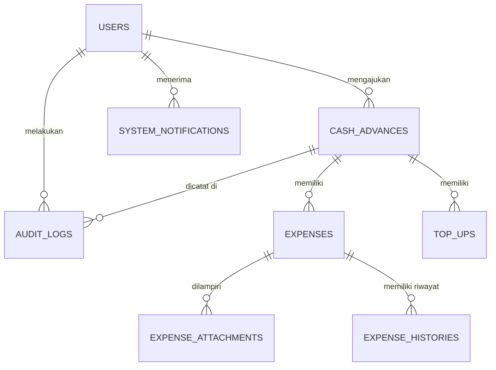
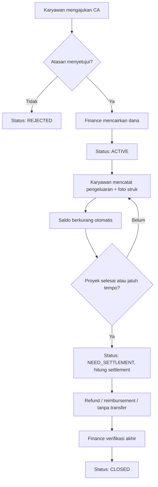

# Desain Sistem Cash Advance & Settlement — PT Technodrives

Dokumen desain untuk dibangun dengan Antigravity. Baca seluruh dokumen sebelum generate kode, lalu bangun per fase dan per modul sesuai urutan di bagian akhir dokumen ini.

| Item | Isi |
| --- | --- |
| Perusahaan | PT Technodrives |
| Bidang perusahaan | Solusi kelistrikan dan testing untuk industri dan data center |
| Sistem | Cash Advance (CA) operasional per proyek dan Settlement |
| Pengguna | Sekitar 25 karyawan, akses utama dari HP |
| Bahasa aplikasi | Bahasa Indonesia |
| Mata uang | Rupiah (IDR), tanpa desimal |
| Target Fase 1 | 30 November 2026 |
| Database | MySQL, nama database `db_cash_advance` |

## Cara memakai dokumen ini di Antigravity

- Perlakukan dokumen ini sebagai satu-satunya sumber kebenaran untuk fitur, role, status, rumus saldo, dan aturan bisnis. Jika ada instruksi lain yang bertentangan, dokumen ini yang menang untuk hal-hal tersebut.
- Bangun bertahap mengikuti urutan bangun di bagian "Urutan bangun untuk Antigravity". Selesaikan satu modul sampai kriteria penerimaannya lolos sebelum lanjut ke modul berikutnya.
- Jangan menambahkan fitur, role, status, atau tabel baru di luar dokumen ini tanpa menandainya sebagai usulan terpisah. Terutama: jangan membuat tabel `talangan` atau `settlements` baru, karena database yang berjalan tidak memilikinya (lihat bagian Skema database).
- Semua aturan pemisahan tugas, gembok pengajuan, dan perhitungan saldo wajib ditegakkan di sisi server (backend), bukan hanya disembunyikan di tampilan.
- Setiap aksi penting wajib menulis baris ke `audit_logs`. Tidak ada aksi approve, tolak, cairkan, verifikasi, refund, atau ubah status yang boleh lolos tanpa catatan audit.
- Gunakan nama tabel, nama status, dan istilah persis seperti tertulis di dokumen ini agar kode, database, dan tampilan konsisten.

## Konteks, masalah, dan solusi

### Masalah di mitra saat ini

- Pengajuan dan persetujuan cash advance masih berjalan lewat WhatsApp dan memo, sehingga tidak ada satu tempat untuk melacak saldo dan status setiap CA.
- Struk dan bukti pengeluaran baru dikumpulkan di akhir proyek, yang bisa berjarak dua minggu sampai dua bulan, sehingga struk sering hilang.
- Sisa dana proyek tidak selalu kembali ke kantor dan sulit ditelusuri.
- Bukti pengeluaran yang tidak sah atau tidak lengkap berisiko menimbulkan denda pajak.
- Tidak ada pengingat batas waktu pertanggungjawaban yang sistematis, jadi penyelesaian CA bergantung pada ingatan masing-masing karyawan.

### Solusi yang dibangun

Satu aplikasi web yang mencatat seluruh siklus CA dalam satu alur: pengajuan, persetujuan berjenjang, pencairan, pencatatan pengeluaran real-time dengan foto struk, top-up dan talangan, sampai settlement dan penutupan. Prinsip intinya sederhana: setiap rupiah harus punya bukti, saldo, pemilik, dan batas waktu pengembalian.

Cash advance di sistem ini adalah dana kerja operasional per proyek yang dipertanggungjawabkan dengan struk dan ditutup lewat settlement. Ini bukan kasbon gaji dan tidak dipotong dari gaji karyawan.

### Tujuan yang bisa diukur

- 100% pengeluaran CA tercatat dengan foto struk pada saat transaksi terjadi, bukan di akhir proyek.
- Saldo setiap CA selalu bisa dilihat real-time oleh karyawan pemilik, Atasan, dan Finance tanpa bertanya lewat chat.
- Tidak ada pengguna yang bisa menyetujui, mencairkan, atau memverifikasi CA miliknya sendiri.
- Setiap CA yang melewati batas waktunya otomatis berstatus `NEED_SETTLEMENT`.
- Laporan per proyek bisa diekspor untuk kebutuhan Finance dan pajak tanpa rekap manual.

## Scope fase

### Fase 1 — inti sistem (target 30 November 2026)

- Autentikasi dan login multiuser berdasarkan role, termasuk mode demo 1-klik untuk pengujian dan presentasi.
- Pengajuan CA oleh Karyawan dan persetujuan oleh Atasan, dengan eskalasi ke Direktur bila melewati batas yang diatur di `system_settings`.
- Pencairan dana oleh Finance setelah persetujuan.
- Pencatatan pengeluaran real-time dengan foto struk, kategori, vendor, dan riwayat perubahan.
- Perhitungan saldo otomatis dan gembok input pengeluaran saat saldo tidak cukup.
- Pengajuan top-up dengan persetujuan Atasan lalu Finance (Direktur bila di atas batas).
- Pencatatan talangan untuk keadaan darurat. Reimbursement penuh talangan adalah scope Fase 2; di Fase 1 talangan minimal tercatat dan tampil di perhitungan settlement (lihat Keputusan terbuka).
- Verifikasi struk dan verifikasi akhir oleh Finance.
- Settlement: pengembalian sisa dana (refund) atau reimbursement, lalu penutupan CA menjadi `CLOSED`.
- Dashboard, daftar CA per tab status, detail CA dengan buku saldo, audit log, notifikasi dalam sistem, dan ekspor laporan.

### Fase 2 — lanjutan

- Reimbursement talangan penuh dengan alur pembayaran tersendiri.
- Delegasi approver saat approver cuti.
- Notifikasi WhatsApp untuk persetujuan, pencairan, dan pengingat jatuh tempo.
- Laporan analitik per proyek, per karyawan, dan per kategori pengeluaran.
- Integrasi dengan sistem akuntansi.

### Fase 3 — penajaman

- Pengingat otomatis bertingkat sebelum dan sesudah jatuh tempo settlement.
- Rekonsiliasi dan pengarsipan bukti untuk kebutuhan audit pajak dalam jangka panjang.

Di luar scope semua fase di atas: pemotongan gaji, pinjaman karyawan di luar proyek, dan persetujuan oleh Super Admin.

## Stack dan prinsip teknis

| Aspek | Pilihan |
| --- | --- |
| Framework | Laravel (PHP 8.0.2 ke atas) |
| Database | MySQL / MariaDB, database `db_cash_advance` |
| Autentikasi | Session Laravel, kolom role/level di tabel `users` |
| Upload | Foto struk disimpan di storage aplikasi, metadata di `expense_attachments` |
| Ekspor laporan | PDF dan spreadsheet dari data CA dan pengeluaran |
| Tampilan | Responsive, mobile-first, server-rendered |

Prinsip teknis yang wajib dijaga:

- Server adalah sumber kebenaran. Saldo, status, dan izin dihitung dan divalidasi di backend pada setiap request.
- Uang disimpan sebagai bilangan bulat rupiah (integer/bigint), bukan float, agar tidak ada selisih pembulatan.
- Transaksi database dipakai untuk aksi yang mengubah saldo atau status, misalnya pencairan, verifikasi akhir, dan penutupan CA, agar tidak ada status setengah jadi.
- Setiap perubahan status CA dan setiap aksi pada pengeluaran meninggalkan jejak di `audit_logs` dan, bila relevan, di `expense_histories`.
- Konfigurasi yang bisa berubah, seperti batas eskalasi Direktur, batas hari settlement, dan batas hari refund, disimpan di `system_settings`, bukan di-hardcode.
- Semua tanggal dan tenggat memakai zona waktu Asia/Jakarta.

## Role dan pemisahan tugas

Sistem memiliki 5 role. Pemisahan tugas dikunci oleh sistem: tidak ada pengguna yang menyetujui, mencairkan, atau memverifikasi CA miliknya sendiri, dalam kombinasi apa pun.

| Role | Tugas utama | Larangan keras |
| --- | --- | --- |
| Karyawan | Mengajukan CA, mencatat pengeluaran, mengajukan top-up, mencatat talangan, menandai proyek selesai | Menyetujui atau memverifikasi data sendiri |
| Atasan | Menyetujui/menolak pengajuan CA dan top-up bawahannya | Menyetujui CA milik sendiri, mencairkan dana |
| Finance | Mencairkan dana, memverifikasi struk, verifikasi akhir, menutup CA, melihat laporan | Menyetujui pengajuan, memverifikasi CA milik sendiri |
| Direktur | Menyetujui eskalasi di atas batas, membuka gembok pengajuan secara khusus | Mencairkan dana operasional harian |
| Super Admin | Mengelola akun, role, dan pengaturan sistem (teknis saja) | Approve, mencairkan, dan memverifikasi transaksi apa pun |

### Matriks izin per aksi

Tanda Ya berarti role boleh melakukan aksi tersebut, dengan syarat tambahan pada kolom catatan.

| Aksi | Karyawan | Atasan | Finance | Direktur | Super Admin |
| --- | :---: | :---: | :---: | :---: | :---: |
| Ajukan CA | Ya | - | - | - | - |
| Catat pengeluaran + struk | Ya | - | - | - | - |
| Ajukan top-up | Ya | - | - | - | - |
| Catat talangan | Ya | - | - | - | - |
| Tandai proyek selesai | Ya | - | - | - | - |
| Approve/tolak CA | - | Ya | - | Eskalasi | - |
| Approve/tolak top-up | - | Ya | - | Di atas batas | - |
| Cairkan dana | - | - | Ya | - | - |
| Verifikasi struk | - | - | Ya | - | - |
| Verifikasi akhir & tutup CA | - | - | Ya | - | - |
| Buka gembok pengajuan | - | - | - | Ya | - |
| Lihat laporan & audit log | Milik sendiri | Timnya | Ya | Ya | Log teknis |
| Kelola akun & role | - | - | - | - | Ya |
| Ubah `system_settings` | - | - | - | - | Ya |

Catatan matriks: semua aksi "Ya" di atas tetap tunduk pada aturan kepemilikan. Karyawan hanya melihat dan mengubah CA miliknya, Atasan hanya CA bawahannya, dan tidak ada role yang boleh bertindak atas CA yang dia ajukan sendiri.

## Skema database

Database berjalan bernama `db_cash_advance` dengan 17 tabel. Sembilan tabel di bawah ini adalah entitas domain. Delapan tabel bawaan Laravel (`cache`, `cache_locks`, `failed_jobs`, `jobs`, `job_batches`, `migrations`, `password_reset_tokens`, `sessions`) adalah tabel infrastruktur: pertahankan apa adanya, jangan tampilkan di ERD bisnis, dan jangan jadikan tempat menyimpan data CA.

Fakta penting dari database yang berjalan: tidak ada tabel `talangan` dan tidak ada tabel `settlements`. Talangan dicatat dalam alur pengeluaran (lihat bagian Aturan bisnis) dan hasil settlement dihitung oleh sistem dari saldo dan talangan, bukan dibaca dari tabel settlement. Jangan membuat kedua tabel itu tanpa keputusan baru yang tertulis.

Nama kolom di bawah ini mengikuti dokumen konsep, tampilan sistem yang berjalan, dan konvensi Laravel. Sebelum generate migration, cocokkan sekali lagi dengan tab Struktur di phpMyAdmin untuk setiap tabel, dan sesuaikan nama kolom bila berbeda. Kunci utama setiap tabel adalah `id`, dan relasi memakai foreign key sesuai kolom `*_id`.

### users — akun dan role

| Kolom | Tipe | Catatan |
| --- | --- | --- |
| `id` | bigint, PK | Otomatis |
| `nama` / `name` | varchar | Nama lengkap pengguna |
| `email` | varchar, unik | Untuk login |
| `password` | varchar | Hash, tidak pernah plaintext |
| `role` | varchar/enum | Karyawan, Atasan, Finance, Direktur, Super Admin |
| `level` | int/varchar | Level login multiuser bila dipakai terpisah dari `role` |

Satu user mengajukan banyak `cash_advances`, melakukan banyak `audit_logs`, dan menerima banyak `system_notifications`.

### cash_advances — pengajuan CA per proyek

| Kolom | Tipe | Catatan |
| --- | --- | --- |
| `id` | bigint, PK | Dasar nomor CA, format tampil `CA-YYYYMM-NNNN` |
| `user_id` | bigint, FK ke `users` | Karyawan pengaju |
| `proyek` | varchar | Nama/kebutuhan proyek |
| `jumlah_awal` | bigint | Nominal CA awal yang disetujui dan dicairkan |
| `status` | varchar/enum | Salah satu dari 6 status CA (lihat bagian Status) |
| `tanggal_pengajuan` | date/datetime | Saat pengajuan dibuat |
| `tanggal_cair` | date/datetime, nullable | Saat Finance mencairkan |
| `tanggal_jatuh_tempo` | date/datetime | Batas settlement, default 2 bulan sejak pencairan |

Satu `cash_advances` memiliki banyak `expenses`, banyak `top_ups`, dan banyak `audit_logs`.

### expenses — pengeluaran

| Kolom | Tipe | Catatan |
| --- | --- | --- |
| `id` | bigint, PK | Otomatis |
| `cash_advance_id` | bigint, FK ke `cash_advances` | CA pemilik pengeluaran |
| `tanggal` | date | Tanggal transaksi |
| `deskripsi` | varchar/text | Keperluan pengeluaran |
| `kategori` | varchar | Kategori pengeluaran |
| `jumlah` | bigint | Nominal rupiah, harus lebih dari 0 |
| `vendor` | varchar | Nama vendor/toko |
| `status_verifikasi` | varchar/enum | Belum diverifikasi, Disetujui, Ditolak |
| `is_talangan` | boolean/flag | Penanda talangan bila talangan dicatat di tabel ini |

Satu `expenses` dilampiri banyak `expense_attachments` dan memiliki banyak `expense_histories`. Hanya pengeluaran berstatus verifikasi Disetujui yang mengurangi saldo final; tampilkan status verifikasi di setiap baris pengeluaran.

### expense_attachments — lampiran foto struk

| Kolom | Tipe | Catatan |
| --- | --- | --- |
| `id` | bigint, PK | Otomatis |
| `expense_id` | bigint, FK ke `expenses` | Pengeluaran pemilik lampiran |
| `nama_file` | varchar | Nama/path file di storage |
| `tipe_file` | varchar | jpg, jpeg, png, atau pdf sesuai validasi upload |

### expense_histories — riwayat perubahan pengeluaran

| Kolom | Tipe | Catatan |
| --- | --- | --- |
| `id` | bigint, PK | Otomatis |
| `expense_id` | bigint, FK ke `expenses` | Pengeluaran yang berubah |
| `user_id` | bigint, FK ke `users` | Pengguna yang mengubah |
| `aksi` | varchar | Dibuat, Diubah, Diverifikasi, Ditolak |
| `waktu` | datetime | Waktu perubahan |

### top_ups — pengajuan tambahan dana

| Kolom | Tipe | Catatan |
| --- | --- | --- |
| `id` | bigint, PK | Otomatis |
| `cash_advance_id` | bigint, FK ke `cash_advances` | CA yang ditambah dananya |
| `jumlah` | bigint | Nominal top-up yang diajukan |
| `status` | varchar/enum | Menunggu, Disetujui, Ditolak, Dicairkan |
| `tanggal` | date/datetime | Tanggal pengajuan top-up |

Hanya top-up berstatus Dicairkan yang menambah saldo CA.

### audit_logs — jejak semua aksi penting

| Kolom | Tipe | Catatan |
| --- | --- | --- |
| `id` | bigint, PK | Otomatis |
| `user_id` | bigint, FK ke `users` | Pelaku aksi |
| `cash_advance_id` | bigint, FK ke `cash_advances`, nullable | CA terkait, bila ada |
| `aksi` | varchar | Jenis aksi, misalnya Approve, Cairkan, Verifikasi, Tolak |
| `alasan` | varchar/text, nullable | Wajib terisi untuk penolakan dan pembukaan gembok |
| `waktu` | datetime | Waktu aksi |

Baris `audit_logs` tidak boleh diubah atau dihapus dari aplikasi. Halaman audit log bersifat baca-saja.

### system_notifications — notifikasi dalam sistem

| Kolom | Tipe | Catatan |
| --- | --- | --- |
| `id` | bigint, PK | Otomatis |
| `user_id` | bigint, FK ke `users` | Penerima notifikasi |
| `pesan` | varchar/text | Isi notifikasi |
| `dibaca` | boolean | Status sudah dibaca |
| `waktu` | datetime | Waktu notifikasi dibuat |

### system_settings — pengaturan kunci-nilai

| Kolom | Tipe | Catatan |
| --- | --- | --- |
| `id` | bigint, PK | Otomatis |
| `key` | varchar, unik | Nama pengaturan |
| `value` | varchar/text | Nilai pengaturan |

Kunci pengaturan minimal: batas nominal eskalasi ke Direktur, batas hari settlement sejak pencairan (default 2 bulan), batas hari refund setelah settlement (default 3 hari kerja), dan batas hari pencatatan pengeluaran. Semua batas dibaca dari tabel ini, bukan dari konstanta di kode.

### Diagram relasi (Mermaid ERD)

## Status CA dan workflow

### Enam status CA

| Status | Arti | Masuk dari | Keluar ke |
| --- | --- | --- | --- |
| `PENDING_APPROVAL` | Menunggu persetujuan Atasan/Direktur | Pengajuan baru | `ACTIVE`, `REJECTED` |
| `REJECTED` | Ditolak, wajib ada alasan | Penolakan Atasan/Direktur | Akhir (pengajuan baru terpisah) |
| `ACTIVE` | Dana sudah cair, proyek berjalan | Pencairan oleh Finance | `NEED_SETTLEMENT` |
| `NEED_SETTLEMENT` | Proyek selesai atau batas 2 bulan habis, menunggu penyelesaian | Tandai selesai / lewat jatuh tempo | `PENDING_VERIFICATION` |
| `PENDING_VERIFICATION` | Settlement diajukan, menunggu verifikasi akhir Finance | Pengajuan settlement | `CLOSED` |
| `CLOSED` | Selesai dan terverifikasi, saldo akhir harus 0 atau sudah direfund/direimburse | Verifikasi akhir Finance | Akhir, terkunci |

Tidak ada transisi status lain di luar tabel ini. Setiap transisi divalidasi di backend berdasarkan status saat ini dan role pelaku, dan dicatat di `audit_logs`.

Persetujuan Atasan (dan Direktur untuk eskalasi) bukan status ketujuh. Persetujuan dicatat sebagai aksi di `audit_logs` beserta pelakunya, CA tetap berstatus `PENDING_APPROVAL` dan masuk antrean pencairan Finance, dan status baru berubah menjadi `ACTIVE` pada saat pencairan. Jangan menambahkan status `APPROVED` ke daftar status CA.

### Alur utama (Activity Diagram dalam teks)

Alur dibagi tiga bagian agar mudah dibaca. Konektor A menghubungkan Bagian 1 ke Bagian 2, konektor B menghubungkan Bagian 2 ke Bagian 3, dan konektor C mengembalikan Bagian 3 ke Bagian 2 bila proyek belum selesai.

1. Bagian 1, pengajuan dan pencairan: Karyawan mengajukan CA (proyek dan jumlah), Atasan menyetujui atau menolak. Bila ditolak, status `REJECTED` dan alur berhenti. Bila disetujui, Finance mencairkan dana, status menjadi `ACTIVE`, lanjut lewat konektor A.
2. Bagian 2, pencatatan dan saldo: Karyawan mencatat pengeluaran dengan foto struk, saldo berkurang otomatis. Bila saldo tidak cukup, Karyawan mengajukan top-up (Atasan menyetujui, Finance mencairkan) atau mencatat talangan untuk keadaan darurat. Bagian ini berulang selama proyek berjalan, lanjut lewat konektor B.
3. Bagian 3, penyelesaian dan settlement: Bila proyek belum selesai, kembali ke Bagian 2 lewat konektor C. Bila proyek selesai, Karyawan menandai proyek selesai, sistem menghitung settlement, lalu berlaku salah satu dari tiga cabang: saldo lebih dari 0 berarti Karyawan mengembalikan sisa ke rekening kantor (refund), saldo kurang dari 0 berarti perusahaan membayar reimbursement, dan saldo sama dengan 0 berarti tidak ada transfer. Finance melakukan verifikasi akhir, status menjadi `CLOSED`.

Aturan waktu yang menyertai alur: batas dua bulan sejak pencairan habis berarti status otomatis `NEED_SETTLEMENT`, dan refund dilakukan maksimal tiga hari kerja setelah settlement.

### Use case per aktor (ringkasan)

- Karyawan: ajukan CA, catat pengeluaran, upload foto struk (termasuk di dalam catat pengeluaran), ajukan top-up, catat talangan, tandai proyek selesai, lihat saldo dan status CA.
- Atasan: setujui atau tolak pengajuan CA, setujui atau tolak top-up.
- Finance: verifikasi struk, cairkan dana, cairkan top-up, verifikasi akhir dan tutup CA, lihat laporan dan audit log.
- Direktur: setujui eskalasi, buka gembok pengajuan.
- Super Admin: kelola akun dan role, ubah pengaturan sistem.

## Aturan bisnis

Aturan di bawah ini bernomor agar bisa dirujuk saat pengujian. Semua aturan ditegakkan di backend.

### Saldo

- BR-01. Saldo CA dihitung sistem, tidak pernah diketik manual: `saldo = jumlah awal yang dicairkan + total top-up yang dicairkan - total pengeluaran yang diverifikasi`.
- BR-02. Buku saldo di detail CA menampilkan setiap perubahan sebagai baris kronologis: pencairan awal, setiap top-up cair, dan setiap pengeluaran, lengkap dengan saldo berjalan setelah baris tersebut. Contoh pemeriksaan: CA awal Rp100.000.000 dikurangi pengeluaran Rp15.000 menghasilkan saldo Rp99.985.000.
- BR-03. Input pengeluaran yang melebihi saldo saat ini digembok (ditolak sistem) dan pengguna diarahkan untuk mengajukan top-up atau mencatat talangan. Pengeluaran tidak boleh membuat saldo negatif lewat jalur normal.

### Gembok pengajuan

- BR-04. Karyawan yang masih memiliki CA yang belum `CLOSED` (dan bukan `REJECTED`) tidak bisa mengajukan CA baru. Tombol pengajuan tampil terkunci dengan penjelasan status CA yang menghalangi.
- BR-05. Hanya Direktur yang bisa membuka gembok BR-04 untuk kasus khusus. Pembukaan gembok wajib mengisi alasan dan tercatat di `audit_logs`.

### Persetujuan dan pencairan

- BR-06. Pengajuan CA selalu melewati Atasan terlebih dahulu. Bila nominal melewati batas eskalasi di `system_settings`, persetujuan Direktur diperlukan sebelum pencairan.
- BR-07. Penolakan CA, top-up, atau struk wajib disertai alasan yang bisa dibaca pengaju, dan tercatat di `audit_logs`.
- BR-08. Dana hanya bisa dicairkan Finance untuk CA yang persetujuannya sudah tercatat (masih berstatus `PENDING_APPROVAL` dan ada di antrean pencairan). Setelah pencairan, isi `tanggal_cair` dan `tanggal_jatuh_tempo`, lalu ubah status menjadi `ACTIVE`.

### Top-up dan talangan

- BR-09. Top-up diajukan Karyawan dari detail CA, disetujui Atasan (Direktur bila di atas batas), lalu dicairkan Finance. Hanya top-up yang dicairkan yang menambah saldo (BR-01).
- BR-10. Talangan adalah pengeluaran darurat yang dibayar dulu dari uang pribadi Karyawan saat saldo CA tidak cukup. Talangan wajib punya struk dan alasan darurat, diverifikasi Finance seperti pengeluaran lain, dan tampil terpisah di perhitungan settlement.
- BR-11. Di Fase 1 talangan dicatat dan diperhitungkan di settlement. Mekanisme pembayaran reimbursement penuhnya adalah scope Fase 2 dan keputusannya belum final, jadi jangan mengarang alur pembayaran talangan di luar pencatatan dan perhitungan settlement.

### Pengeluaran dan struk

- BR-12. Setiap pengeluaran wajib memiliki tanggal, deskripsi, kategori, jumlah lebih dari 0, vendor, dan minimal satu foto struk.
- BR-13. Batas hari pencatatan pengeluaran mengikuti `system_settings`. Pengeluaran di luar batas ditolak atau ditandai terlambat sesuai pengaturan, dan aturan ini dijelaskan di form agar pekerja lapangan paham sejak awal.
- BR-14. Pengeluaran yang sudah diverifikasi tidak bisa diubah Karyawan. Perubahan apa pun pada pengeluaran tercatat di `expense_histories`.

### Settlement dan penutupan

- BR-15. CA masuk settlement bila Karyawan menandai proyek selesai, atau bila `tanggal_jatuh_tempo` terlewati. Status menjadi `NEED_SETTLEMENT` dan tampil hitung mundur atau keterangan sisa hari di dashboard dan detail CA.
- BR-16. Hasil settlement dihitung sistem: `hasil = saldo akhir - talangan yang disetujui`. Hasil lebih dari 0 berarti refund oleh Karyawan ke rekening kantor maksimal tiga hari kerja. Hasil kurang dari 0 berarti reimbursement oleh perusahaan. Hasil sama dengan 0 berarti tidak ada transfer.
- BR-17. Setelah refund atau reimbursement dibuktikan, atau hasil sama dengan 0, CA masuk `PENDING_VERIFICATION`. Finance melakukan verifikasi akhir, dan hanya verifikasi akhir yang mengubah status menjadi `CLOSED`.
- BR-18. CA berstatus `CLOSED` bersifat terkunci: tidak bisa ditambah pengeluaran, top-up, atau talangan baru. Saldo tampil pada CA `CLOSED` harus sudah memperhitungkan refund atau reimbursement, sehingga tidak ada CA `CLOSED` yang masih menyisakan saldo menggantung tanpa keterangan.

## Halaman dan UI/UX

### Prinsip tampilan

- Desain profesional dan serius, sesuai konteks perusahaan industri dan data center. Hindari gaya playful, warna mencolok berlebihan, dan ilustrasi yang mengganggu keterbacaan angka.
- Mobile-first: halaman harus nyaman dipakai satu tangan di HP, tombol aksi utama mudah dijangkau, dan angka saldo selalu terbaca tanpa zoom.
- Bahasa antarmuka Bahasa Indonesia. Istilah status di tampilan boleh memakai label ramah (misalnya "Menunggu Persetujuan") selama nilai status di database tetap memakai kode di bagian Status.
- Format uang konsisten: `Rp` diikuti angka dengan pemisah ribuan titik, tanpa desimal. Contoh: Rp99.985.000.
- Setiap halaman daftar memiliki pencarian dan filter status. Setiap aksi merusak atau final (tolak, tutup CA) meminta konfirmasi.

### Palet dan komponen yang disarankan

- Warna utama biru tua/navy untuk header dan aksi utama, abu netral untuk latar dan tabel, hijau untuk status selesai/cair, kuning untuk menunggu, merah untuk ditolak dan saldo kurang.
- Badge status dengan warna konsisten di semua halaman: `PENDING_APPROVAL` kuning, `REJECTED` merah, `ACTIVE` biru, `NEED_SETTLEMENT` oranye, `PENDING_VERIFICATION` ungu/abu tua, `CLOSED` hijau.
- Komponen yang dipakai ulang: kartu ringkasan dashboard, tabel daftar CA, tab status, buku saldo (tabel kronologis), badge status, form dengan pesan error di bawah field, dan modal konfirmasi.

### Daftar halaman

| Halaman | Pengguna | Isi dan aksi utama |
| --- | --- | --- |
| Login | Semua | Email dan password, plus mode demo 1-klik per level untuk pengujian |
| Dashboard | Semua, isi per role | Ringkasan jumlah CA per status, saldo aktif, CA mendekati jatuh tempo, antrean tugas role tersebut |
| Daftar CA | Semua, isi per role | Tabel CA dengan tab Semua dan per status, pencarian proyek/nomor CA, filter pemilik untuk Atasan/Finance/Direktur |
| Detail CA | Semua terkait CA itu | Info proyek, pemilik, tanggal, badge status, buku saldo, daftar pengeluaran, daftar top-up, aksi sesuai role dan status |
| Form pengajuan CA | Karyawan | Proyek, jumlah, kebutuhan/catatan; terkunci bila BR-04 berlaku |
| Form pengeluaran | Karyawan | Tanggal, deskripsi, kategori, jumlah, vendor, upload foto struk; digembok bila saldo tidak cukup (BR-03) |
| Form top-up | Karyawan | Jumlah dan alasan, dari halaman detail CA |
| Antrean persetujuan | Atasan, Direktur | Daftar CA dan top-up menunggu, tombol setujui/tolak dengan alasan |
| Antrean pencairan | Finance | Daftar CA dan top-up disetujui yang belum cair, aksi cairkan |
| Verifikasi struk | Finance | Daftar pengeluaran menunggu, pratinjau foto struk, setujui/tolak dengan alasan |
| Settlement | Karyawan, Finance | Ringkasan perhitungan BR-16, bukti refund/reimbursement, kirim ke verifikasi akhir |
| Laporan | Finance, Direktur | Rekap per proyek/periode/per karyawan, ekspor PDF dan spreadsheet |
| Audit log | Finance, Direktur, Super Admin | Tabel baca-saja dari `audit_logs` dengan filter pengguna, CA, dan aksi |
| Notifikasi | Semua | Daftar dari `system_notifications`, tandai sudah dibaca |
| Kelola pengguna | Super Admin | CRUD akun, atur role, nonaktifkan akun |
| Pengaturan sistem | Super Admin | Form kunci-nilai dari `system_settings` |

Urutan demo yang harus selalu bisa dijalankan dari halaman-halaman di atas: login demo sebagai Karyawan, lihat dashboard dengan gembok pengajuan, buka daftar CA per tab status, buka detail CA, catat pengeluaran dengan foto struk, lalu ajukan top-up.

## Validasi, keamanan, audit, dan notifikasi

### Validasi input

- Semua field wajib pada form pengajuan, pengeluaran, dan top-up divalidasi di server, dengan pesan error Bahasa Indonesia di bawah field terkait.
- Jumlah uang harus bilangan bulat lebih dari 0. Upload struk dibatasi pada tipe gambar (dan PDF bila diizinkan pengaturan) dengan batas ukuran file yang jelas, dan ditolak bila kosong.
- Alasan wajib terisi untuk penolakan CA, penolakan top-up, penolakan struk, pencatatan talangan, dan pembukaan gembok oleh Direktur.
- Tanggal pengeluaran tidak boleh melebihi hari ini, dan tanggal jatuh tempo tidak boleh mendahului tanggal pencairan.

### Keamanan dan hak akses

- Password disimpan sebagai hash bawaan Laravel. Tidak ada password plaintext di database, seeder yang dibagikan, atau log.
- Setiap route aksi memeriksa autentikasi, role, kepemilikan data, dan status CA saat ini. Menyembunyikan tombol di tampilan tidak dianggap sebagai pengamanan.
- Pemisahan tugas diperiksa pada setiap aksi: pelaku tidak boleh menjadi pengaju CA yang sedang dia setujui, cairkan, atau verifikasi.
- Akses file struk hanya untuk pengguna yang terkait dengan CA tersebut (pemilik, Atasan terkait, Finance, Direktur). File tidak dibuka untuk publik tanpa autentikasi.
- Sesi berakhir sesuai konfigurasi Laravel standar, dan akun nonaktif tidak bisa login.

### Audit

- Aksi yang wajib tercatat di `audit_logs`: buat pengajuan, approve, tolak, cairkan, catat pengeluaran, verifikasi struk, ajukan top-up, approve top-up, cairkan top-up, catat talangan, tandai proyek selesai, ajukan settlement, verifikasi akhir, buka gembok, ubah pengaturan, dan ubah akun oleh Super Admin.
- Setiap baris audit memuat pelaku, CA terkait (bila ada), jenis aksi, alasan (bila wajib), dan waktu Asia/Jakarta.
- Perubahan pada pengeluaran juga tercatat di `expense_histories`, terpisah dari audit log umum.

### Notifikasi dalam sistem

Buat baris `system_notifications` untuk penerima yang relevan pada kejadian berikut: pengajuan CA baru (ke Atasan), persetujuan atau penolakan (ke Karyawan), pencairan (ke Karyawan), pengeluaran ditolak (ke Karyawan), top-up menunggu dan hasil top-up, CA masuk `NEED_SETTLEMENT`, pengingat jatuh tempo, settlement menunggu verifikasi (ke Finance), dan CA `CLOSED` (ke Karyawan dan Atasan). Notifikasi WhatsApp adalah scope Fase 2, bukan Fase 1.

## Data awal dan akun demo

- Seeder membuat satu akun contoh untuk setiap role agar seluruh alur bisa dites dari ujung ke ujung. Kata sandi akun demo hanya untuk lingkungan lokal/pengembangan dan harus diganti sebelum sistem dipakai dengan data asli.
- Mode demo 1-klik di halaman login menyediakan tombol masuk sebagai Karyawan, Atasan, Finance, dan Direktur untuk keperluan pengujian dan presentasi. Mode ini hanya aktif di lingkungan lokal/demo, dan nonaktif di produksi.
- Data contoh minimal untuk pengujian manual: satu CA `ACTIVE` dengan beberapa pengeluaran terverifikasi dan satu foto struk, satu CA `PENDING_APPROVAL`, satu CA `NEED_SETTLEMENT`, dan satu CA `CLOSED` dengan saldo akhir 0. Data contoh harus terlihat jelas sebagai data demo dan mudah dihapus sekaligus.
- Nilai awal `system_settings` diisi saat seeding: batas eskalasi Direktur, batas settlement 2 bulan, batas refund 3 hari kerja, dan batas hari pencatatan pengeluaran. Nilai batas eskalasi dan batas pencatatan mengikuti keputusan manajemen; bila belum ada keputusan, beri nilai awal yang mudah diubah dari halaman Pengaturan sistem dan tandai sebagai nilai awal, bukan keputusan final.

## Kriteria penerimaan Fase 1

Sistem Fase 1 dianggap selesai bila semua poin berikut lolos pengujian manual dari akun demo:

- Login berhasil untuk setiap role, dan setiap role hanya melihat menu dan data sesuai matriks izin.
- Karyawan bisa mengajukan CA; CA tampil di antrean Atasan dengan status `PENDING_APPROVAL`.
- Atasan bisa menolak dengan alasan dan menyetujui; penolakan tanpa alasan ditolak sistem.
- Pengguna mana pun tidak bisa menyetujui, mencairkan, atau memverifikasi CA miliknya sendiri, termasuk bila URL aksi dibuka langsung.
- Finance bisa mencairkan CA yang disetujui; status menjadi `ACTIVE` dan `tanggal_jatuh_tempo` terisi.
- Karyawan dengan CA belum `CLOSED` tidak bisa mengajukan CA baru, dan Direktur bisa membuka gembok dengan alasan yang tercatat.
- Pengeluaran dengan foto struk tersimpan, tampil di detail CA, dan setelah diverifikasi mengurangi saldo sesuai rumus BR-01 dan contoh hitungan BR-02.
- Pengeluaran melebihi saldo ditolak sistem dan pengguna diarahkan ke top-up atau talangan.
- Top-up melewati persetujuan Atasan dan pencairan Finance sebelum menambah saldo.
- Talangan tercatat dengan struk dan alasan, tampil terpisah di settlement.
- Menandai proyek selesai atau melewati jatuh tempo mengubah status menjadi `NEED_SETTLEMENT`.
- Perhitungan settlement mengikuti BR-16 untuk tiga kasus: saldo positif (refund), negatif (reimbursement), dan nol (tanpa transfer).
- Verifikasi akhir Finance mengubah status menjadi `CLOSED`, dan CA `CLOSED` tidak bisa ditambah pengeluaran, top-up, atau talangan.
- Setiap aksi pada daftar audit di bagian Audit benar-benar menghasilkan baris di `audit_logs`, dan notifikasi terkirim ke penerima yang benar di `system_notifications`.
- Laporan per proyek bisa diekspor dan totalnya sama dengan buku saldo di detail CA.
- Seluruh halaman utama nyaman dibuka di lebar HP dan angka saldo terbaca tanpa zoom.

## Urutan bangun untuk Antigravity

Bangun dan uji dalam urutan ini. Jangan melompat ke laporan atau ekspor sebelum alur inti lolos.

1. Fondasi: proyek Laravel, koneksi database `db_cash_advance`, autentikasi, tabel `users` dengan role, seeder akun demo, dan mode demo 1-klik khusus lingkungan lokal.
2. Pengaturan dan audit: tabel `system_settings` dan `audit_logs` beserta helper pencatatan audit yang dipakai semua modul berikutnya.
3. Inti CA: tabel `cash_advances`, pengajuan, daftar CA per tab status, detail CA, persetujuan Atasan/Direktur, penolakan beralasan, dan pencairan Finance, termasuk gembok pengajuan BR-04 dan BR-05.
4. Pengeluaran: tabel `expenses`, `expense_attachments`, dan `expense_histories`, form pengeluaran dengan upload struk, buku saldo BR-01 dan BR-02, gembok saldo BR-03, dan verifikasi struk oleh Finance.
5. Top-up dan talangan: tabel `top_ups`, alur persetujuan dan pencairan top-up, serta pencatatan talangan di alur pengeluaran sesuai BR-10 dan BR-11.
6. Settlement dan penutupan: transisi `NEED_SETTLEMENT`, perhitungan BR-16, bukti refund/reimbursement, `PENDING_VERIFICATION`, verifikasi akhir, dan penguncian CA `CLOSED`.
7. Pendukung: dashboard per role, notifikasi `system_notifications`, halaman audit log, dan pengingat jatuh tempo.
8. Laporan dan admin: ekspor laporan, kelola pengguna, dan halaman pengaturan sistem.
9. Uji akhir: jalankan seluruh kriteria penerimaan Fase 1 dari akun demo, perbaiki yang gagal, lalu bersihkan data demo yang tidak diperlukan.

## Keputusan terbuka dan isu yang diketahui

Hal-hal berikut belum final. Jangan mengarang keputusan untuk hal ini di kode; pakai perilaku default yang tertulis dan tandai tempatnya agar mudah diubah.

- Talangan: pencatatan masuk Fase 1, tetapi reimbursement penuh baru direncanakan di Fase 2. Cara pembayaran kekurangan selama Fase 1 masih menunggu keputusan manajemen dan keputusan ini sengaja ditahan oleh pemilik proyek.
- Nama kolom persis: cocokkan nama kolom di bagian Skema database dengan tab Struktur phpMyAdmin sebelum generate migration. Bila berbeda, struktur database yang berjalan yang menjadi acuan.
- Nilai batas: batas nominal eskalasi ke Direktur dan batas hari pencatatan pengeluaran perlu keputusan manajemen. Keduanya dibaca dari `system_settings` agar bisa diubah tanpa mengubah kode.
- Saldo pada CA yang sudah `CLOSED`: pernah ditemukan CA `CLOSED` yang masih menampilkan sisa saldo. Perilaku yang benar mengikuti BR-18; bila data lama masih menyimpang, itu isu data yang perlu dicek terpisah, bukan alasan mengubah rumus saldo.
- Alamat dan identitas resmi perusahaan tidak menjadi bagian dari dokumen desain sistem ini. Dokumen ini hanya mengatur perilaku aplikasi.
